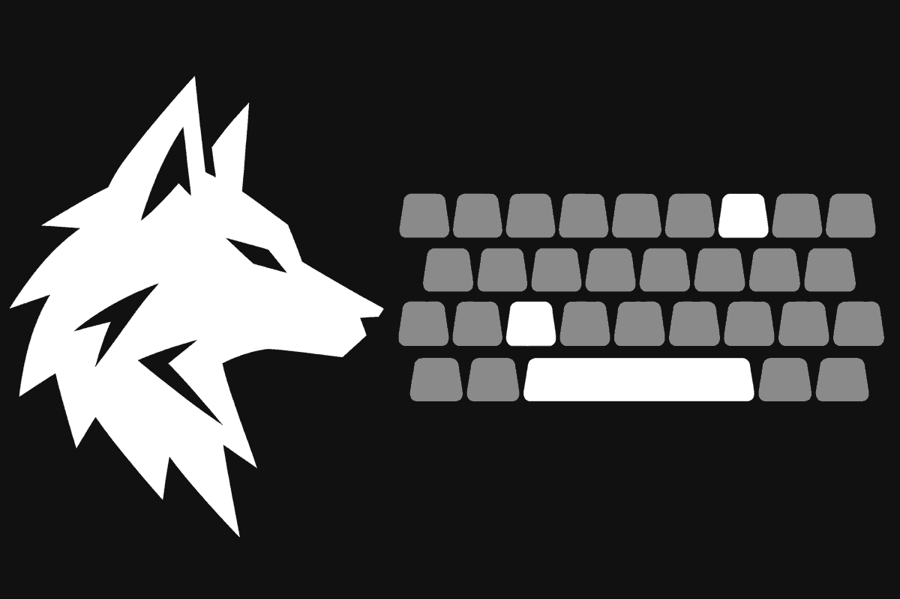

<p align="center">
  
</p>

<h1 align="center">狼注音</h1>

<p align="center">
  Mac 專用的注音輸入法（大千鍵盤）。中英文混著打，不用按切換鍵。<br>
  越用越懂你的習慣，全部在這台電腦上，不連網、不上傳。
</p>

<p align="center">
  <a href="https://github.com/gwolf0719/wolf-zhuyin/releases/latest">最新版</a> ·
  <a href="#安裝">安裝</a> ·
  <a href="#操作">操作</a> ·
  <a href="#設定">設定</a> ·
  <a href="#開發">開發</a>
</p>

---

## 它解決什麼問題

寫程式、寫文件、回訊息，中文裡常夾著英文單字、檔名、數字。傳統注音要一直按 `Shift` 或切換輸入法，漏切一次就得整句刪掉重打；注音按錯一個鍵，整串變成亂碼。

狼注音把這些事交給輸入法：

- **你照常打**，它同時用中文與英文兩種方式解讀每一串按鍵，取整句最合理的切法。
- **打得對的一律照打**，不會自作主張改你的字；**打錯的才修**，修不準的放在選字窗讓你選。
- **記得你**：選過的字、常打的詞、常犯的錯，下次就更準。

需要 Apple Silicon 的 Mac、macOS 14 以上。

## 特色

<table>
  <tr>
    <td width="50%" valign="top">
      
      <h3>中英混打，不用切換</h3>
      <p><code>ji3m/4Mac283y4</code> 直接出「我用 Mac 打字」。標點依上下文自動全形或半形，打到一半的音節先顯示注音，已經出現的中文不會因為下一鍵跳回英文。可選擇在中英文之間自動加空白。</p>
    </td>
    <td width="50%" valign="top">
      
      <h3>打錯會修，也留給你選</h3>
      <p>拼不成注音的按鍵才會被修：順序顛倒、漏按聲調、按到隔壁鍵、多按或漏按一鍵。修不準的放進選字窗（<code>↓</code>）。你退格重打的每一次，輸入法都記成一次更正，同類錯誤累積幾次後，沒見過的也會修。</p>
    </td>
  </tr>
  <tr>
    <td width="50%" valign="top">
      
      <h3>忘了按 Enter 也不怕</h3>
      <p>打到句末標點（。？！）就自動送出整句。一段打太長沒有句末標點時：超過 30 字遇到逗號就先送出前面的，50 字還沒有標點就只留最後一小段可改。換視窗、誤按 <code>Esc</code>、app 吃掉組字區，最多損失最後一小句。可在設定關掉。</p>
    </td>
    <td width="50%" valign="top">
      
      <h3>全部在本機</h3>
      <p>學習紀錄只存在你的電腦，看得到、可以搜尋、可以刪。預設不呼叫任何 AI；唯一的網路連線是每天向 GitHub 查一次新版，下載後驗證簽章才安裝，可以關掉。</p>
    </td>
  </tr>
</table>

### 還有這些

- **選字窗**：按 `↓` 列出游標前字詞的其他選擇，數字鍵選取。選過的字可以再改；選字依前一個字區分（選了「我再」不會影響「他在」）。第一頁最後幾個選項是「可能是打錯」的修正、照打的英文、注音符號本身。
- **`↑` 直接跳到沒把握的字**：有分數相近的同音字、或沒認出來的按鍵，不必用方向鍵一格一格移。
- **漏打聲調**：打完注音忘了聲調，按 `↓` 會把各聲調的字照常用程度一起列出來，選一個就補上。中文字後面最後一個音節漏了聲調、直接按 `Enter` 時，會自動補成最常用的聲調的字（單獨一串字母或英文字不補）。
- **聲調按在韻母前面**：`qu40` 想打「片」，會直接換成「片」，能和前面的字成詞的優先（`u/3qu40` →「影片」），句中的也換（「我自9家」→「我在家」）。真的要打「譬0」時，打完按 `↓` 選第二個。數字後面接數字或單位（「是9點」「共8個」）、或結尾是逗號句號時照打。
- **字詞預測**：組字時提示最可能的後續，`Tab` 直接套用並可連按換下一個；送出後緊接著按 `Tab` 預測下一句開頭。來源是你自己打過的內容與詞庫。
- **本機模型預測（實驗，預設關閉）**：macOS 26 並開啟 Apple Intelligence 時，可在設定打開，看整句的意思續寫。同一句問模型兩次，接法一樣才提示。全程在本機。
- **上下文選字**：完整的詞優先（明天再說）、數字後面的量詞（100元）、句尾語助詞（go吧）。
- **符號表**：按 `\` 呼叫，第一頁是常用符號（含半形的 `[` `]`）；連按兩下輸出反斜線。常用的符號會依最近用量自動往前排（記在本機 `symbols.json`）。
- **包住選取的文字**：先選一段文字再按 `\`，選一個成對標點（「」『』（）《》【】…），把那段包起來。
- **剛送出就改**：送出後馬上按退格，把整段拉回組字區重改。
- **網頁表單的自動推薦**：組字區只有英文、數字時，停頓不到一秒就先寫進輸入框，網頁的推薦才出得來；`Enter`、`Esc`、`↓` 也直接交給網頁（文字不會被清掉）。可在設定關掉。
- **學習紀錄**：輸入法選單 →「學習紀錄…」，看得到學了哪些選字、用詞、打錯，可以搜尋、刪掉不要的。

## 安裝

在終端機執行：

```bash
curl -fsSL https://raw.githubusercontent.com/gwolf0719/wolf-zhuyin/main/install.sh | bash
```

然後到「系統設定 → 鍵盤 → 輸入方式 → 編輯 → ＋ → 繁體中文」加入「狼注音」。

> 為什麼不是下載 `.dmg` 或 `.pkg`？成品沒有 Apple Developer ID 簽章，從瀏覽器下載的 app 會被 Gatekeeper 擋下。`curl` 下載的檔案不會被隔離，所以用安裝腳本。

### 更新

輸入法每天向 GitHub 查一次新版；下載的檔案要通過 Ed25519 簽章驗證才會安裝，並在你切換輸入法的空檔換成新版。

```bash
# 立刻檢查更新
~/Library/Input\ Methods/WolfZhuyin.app/Contents/MacOS/WolfZhuyin --check-update
# 關閉自動更新
defaults write tw.foso.inputmethod.WolfZhuyin AutoUpdateDisabled -bool true
```

### 移除

先在系統設定的輸入方式裡移除狼注音，再執行：

```bash
pkill -x WolfZhuyin; rm -rf ~/Library/Input\ Methods/WolfZhuyin.app ~/Library/Application\ Support/WolfZhuyin
```

## 操作

| 按鍵 | 效果 |
|---|---|
| 直接打字 | 中英文自動判斷，標點自動全形／半形 |
| `Enter` | 送出組字區的內容 |
| `。` `？` `！` | 送出整句（不必按 Enter）；太長沒標點時的自動送出見上 |
| `←` `→` | 在組字區移動游標 |
| `↑` | 跳到輸入法沒把握的字並開選字窗；再按往左找下一個 |
| `↓` | 對游標前的字開選字窗，數字鍵選取；在標點後按可改回照打的半形（「」→ `[]`） |
| `\` | 符號表；連按兩下輸出反斜線 |
| 選取文字後按 `\` | 列出成對的標點，把選取的文字包起來 |
| `Tab` | 有預測提示時直接套用第一個；再按換下一個（`↑` 換回上一個）；接著打字就是接受，`Esc` 或退格拿掉。預測只在夠有把握時出現 |
| 退格 | 刪一個字；注音打錯的按鍵串一次刪掉。**剛送出就按退格**：把整段拉回組字區（app 不支援時照常刪一個字） |
| `Esc` | 關選字窗，或清空組字區 |

## 設定

輸入法選單 →「狼注音設定…」：

| 選項 | 預設 |
|---|---|
| 中英文之間自動加空白 | 關 |
| 自動修正注音打錯 | 開 |
| 記住我的用字習慣 | 開 |
| 打字時預測接下來的字詞 | 開 |
| 用 macOS 內建模型預測（實驗） | 關 |
| 打太長沒按 Enter 自動送出 | 開 |
| 英文直接交給網頁 | 開 |
| 自動更新 | 開 |

## 開發

不需要 Xcode，只要 Command Line Tools（Swift 6.3）。

```bash
swift run wolf type "ji3m/4Mac283y4"   # → 我用Mac打字
swift run wolf steps "因為他不在"        # 一鍵一鍵打，看每一步組字區的樣子
make test                               # 單元測試、不變式測試、評測門檻
make eval                               # 印出中英混打評測集的結果
make install                            # 測試 → 建置 → 裝進 ~/Library/Input Methods → 真實視窗打字測試
make personal                           # 用本機的學習紀錄評測（紀錄不離開本機）
scripts/release.sh 0.5.0 "說明"          # 發版（需要簽章私鑰）
```

```
Sources/WolfEngine/   純 Swift 引擎（不依賴 InputMethodKit）：大千鍵位、詞庫、中英分段、組字狀態機、學習
Sources/wolf/         命令列工具
Sources/WolfIME/      輸入法外殼（InputMethodKit）、選字窗、設定視窗
Sources/WolfUpdate/   更新邏輯（版本比對、簽章驗證）
Sources/WolfRelease/  發版簽章工具
Sources/WolfE2E/      真實視窗端對端測試
App/                  輸入法 bundle 設定與圖示
scripts/              不靠 Xcode 的打包、發版、e2e 腳本
Tests/                測試
Eval/                 評測集（dev 調參用、test 保留集）
Data/mcbopomofo/      中文詞庫
docs/decisions.md     決策紀錄
```

打字行為（按鍵 → 組字區 → 送出）全部寫在引擎的 `Composer`，外殼只做事件轉接，所以都能用測試直接驗證。評測集把期望輸出的句子反推成按鍵，再檢查引擎能否還原；`Eval/test.txt` 是保留集，只回報數字、不針對它調參。

除錯：`touch ~/Library/Logs/WolfZhuyin.debug` 後，輸入法會把連線到哪個 app、每次按鍵有沒有被處理寫進 `~/Library/Logs/WolfZhuyin.log`（不含按鍵內容）；刪掉該檔即關閉。

## 授權

MIT，見 [LICENSE](LICENSE)。中文詞庫來自[小麥注音](https://github.com/openvanilla/McBopomofo)（MIT），見 [Data/mcbopomofo](Data/mcbopomofo/NOTICE.md)。
